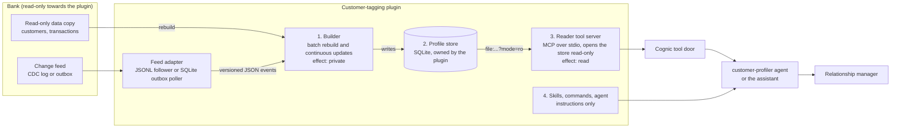

# Customer tagging: target design

The plugin continuously reads a bank's data, keeps a live profile per customer and tags customers from their behaviour, with every tag explained. It is installed into Cognic once Cognic's plugin hosting is ready; until then everything is built and proven in this repository on synthetic data.

This document is the target architecture. `docs/STATUS.md` says which parts are built, `docs/OPEN-QUESTIONS.md` lists what only Cognic's hosting can settle, and `docs/research/` holds the research behind each decision (summarised in [Decisions from the research](#decisions-from-the-research)).

## The four parts



1. **Builder** (`python3 -m engine.build`). Two modes share one code path. `--rebuild` reads the CSV copy, turns every row into an event and produces the whole store. `--follow` reads events from a feed adapter and applies each one incrementally. It writes only the plugin's own store: a `private` effect. It never writes bank data.
2. **Profile store.** One SQLite file owned by the plugin, with numbered migrations in `engine/migrations/`. Tables: `meta`, `customers`, `ledger`, `features`, `feature_buckets`, `tag_state`, `checkpoint_tags`, `tag_history` and `runs` (migration 0001); the continuous-update tables `events_seen`, `feed_checkpoints`, `late_events` and versioned customer attributes come with phase 4.
3. **Reader tool server** (`server/`). A separate process that speaks JSON-RPC 2.0 and the Model Context Protocol over stdio (modern stateless requests and legacy `initialize` clients) and opens the store with `file:...?mode=ro` for every call, so it cannot write even by mistake. Tools: `list_tags`, `get_customer_tags`, `explain_tag`, `find_customers_by_tag`, `tag_summary` and `customer_tag_history`, each with a strict input and output schema; it checks its own output before answering. `explain_tag` evaluates the one tag on demand from the stored buckets with the same evaluator, so "why not" always matches the stored state. Effect `read`, tier `reader`, consent `none`. It runs from a pinned image with no network and no credentials; `.mcp.json` declares it as one stdio entry.
4. **Skills, commands and one agent.** Markdown instructions: explain a customer's tags, explore a segment carefully, review the taxonomy. The `customer-profiler` agent has the `reader` tier, a finite list of the reader's tools and an explicit output schema. Every instruction file says: never change data, never infer or discuss protected traits, refuse to tag or rank people by them, and refuse credit, pricing or fraud decisions.

The builder and the reader never run in the same process and never share a writable handle.

## Data flow and the event model

Every input becomes a **versioned JSON event**; the CSV copy is just another source of events.

```json
{"schema": "customer-tagging.event/1", "id": "evt-000123", "type": "transaction.posted",
 "time": "2026-09-14", "version": 1, "customer_id": "C0042", "data": {"txn_id": "T0001234", "amount": "35.20", "...": "..."}}
```

| Type | Effective date | What it does |
| --- | --- | --- |
| `transaction.posted` | the posted date | adds a ledger row |
| `transaction.reversed` | the original posted date | removes that transaction from every calculation |
| `transaction.corrected` | the earlier of the old and new posted dates | replaces the transaction with a full after-image (never a diff) |
| `customer.updated` | the event's date | adds a new version of the customer's attributes, effective from that date |
| `account.closed` | the closing date | the customer gets no tags from that date on |
| `clock.tick` | the tick's date | moves the as-of date forward; time-based tags (going dormant, new customer) change with no new transaction |

A bank's change data capture maps onto these events in a small adapter: an insert into the posted-transactions table becomes `transaction.posted`, a reversal record becomes `transaction.reversed`, an update to a transaction becomes `transaction.corrected`, a change to the customer table becomes `customer.updated`, and the end of each business day becomes `clock.tick`. The plugin depends on no message broker: the two adapters read a JSONL file or poll a SQLite outbox table, and a bank-side bridge writes either one.

## Why the incremental store equals a batch rebuild

This is the core property of the plugin and the test that proves it (phase 4). Every compared table is a pure function of the **set** of events, the as-of date and the taxonomy, never of the order the events arrived in.

1. **Idempotency.** An event id seen before is skipped. The same id with different content is refused and logged.
2. **Ledger resolution from the set.** Each transaction id is a register (`txn_registers`). The winning image has the highest `version` (the source's own change sequence: a log position or outbox id carried in the event); at equal versions a reversal beats a posting; then the lowest event id wins, which is the first posting, as in a batch file. A posting, a correction and a reversal are all full images; a reversal is an image that contributes nothing, kept as a tombstone, so it wins even if it arrives before the posting. A maximum over a total order does not depend on arrival order, so neither does the ledger. Customer attribute versions are won the same way (highest version, then lowest event id), and a closure takes the earliest closing date.
3. **Buckets are recomputed, never patched.** An event marks the (customer, month) pairs it touches (both months for a correction that moves a transaction; every later month for a `customer.updated`, because "abroad" and "foreign currency" depend on the attributes in force); each one is recomputed from that month's ledger rows. Counts and sums could be patched with deltas, but maximums, distinct sets and recurring-stream statistics cannot be un-applied, and one code path for batch and incremental leaves nothing to drift.
4. **Tags are a function of the buckets and the as-of date.** Complete months come from `feature_buckets`; a window edge that cuts a month in two is computed from that month's ledger rows. Batch and incremental call the same evaluator.
5. **History at checkpoints.** Tag history is recorded at month-end **checkpoints** (the last `lifecycle_months`, default 6), plus the as-of date. `entered_on` is the first checkpoint of the current run of checkpoints at which the tag held; a tag that started after the last month end shows as "new this month". Daily history would make a batch rebuild evaluate every customer on every day, which does not scale; month ends match the monthly windows most rules use. An event re-evaluates its customer at the as-of date and at every checkpoint on or after its effective date; a customer's first event re-evaluates every retained checkpoint (the batch evaluates them all); and a month-end tick adds a checkpoint for every customer, drops the oldest, and recomputes everyone's history and `entered_on`.
6. **Customer attributes are versioned** by effective date, so a late `customer.updated` changes only evaluations from its date on.
7. **Ticks only move forward.** A tick older than the as-of date is ignored. Crossing a month end evaluates that checkpoint for every customer.
8. **Allowed lateness.** A month is *sealed* once its last day is at least `allowed_lateness_days` before the as-of date. An event whose effective date falls in a sealed month is late: it is not applied, it is kept in `late_events` with a reason and counted in `runs`, and a deliberate rebuild folds it in. Every other event is applied exactly, so the store equals a batch rebuild over the accepted events.
9. **Data notes come from the store**, never from counters: transactions used and pending (dated after the as-of date) are counted from the ledger, and rejected events by reason from `rejected_events`.
10. **One batch path.** The CSV copy is turned into events first (`engine.events.csv_events`, keeping stage 1's file rules), so a CSV rebuild and an events rebuild are the same code. The batch stages every event in temporary SQLite tables and picks each register's winner in SQL with the same order, so memory does not grow with the number of transactions.

The property test (`tests/test_incremental.py`) generates a seeded event stream with corrections (some moving a transaction across a month end), reversals (some arriving before their posting), duplicate deliveries and duplicate postings, a mid-stream change of home country, an account closure, and ticks that skip days and month ends. It processes the stream in random orders (shuffled within each day, delayed up to the lateness bound, in random batch sizes, with restarts and crashes mid-batch) and compares a canonical export of the profile tables (everything except `runs`, `late_events` and `feed_checkpoints`, which record what happened when) with a batch rebuild over the same events. CI runs 40 short and 4 long seeds on every push, and 200 and 20 in the benchmark workflow.

**What each batch records.** Every follow batch writes one `runs` row, in the same transaction as its effects. Its `customers`, `transactions` and `tags_held` are the store's totals after the batch (rows in `customers`, rows in `ledger`, `held` rows in `tag_state`), the same as a rebuild's row. Counting three whole tables on every batch costs time that grows with the store, so a batch takes the previous row's totals and adds the change in each customer it touched, counted before that customer's first write and again at the end of the batch. A batch that moved the as-of date (it pruned the ledger and re-evaluated every customer) counts the whole tables again, which costs little next to the tick itself. So does the first batch on a store with no `runs` row. The property test checks every batch, including after crashes and restarts, against a fresh count.

**Sharing the store.** A rebuild writes a new file and renames it into place. The follower writes in place in WAL mode, one transaction per batch, and switches the file back to rollback-journal mode when it exits, so a reader can open it with `mode=ro` both while the follower runs (the reader's folder must then allow SQLite's shared-memory file) and after it stops (see `docs/OPEN-QUESTIONS.md`, Q22).

## Retention and minimal data

- **`history_months`** (default 13: a year of complete months plus the current one) covers the longest rule window; the taxonomy loader refuses a window that reaches further back. The store keeps `history_months + lifecycle_months` calendar months back from the as-of month, so the oldest month-end checkpoint also sees a full window; older ledger rows and buckets are not kept.
- **`lifecycle_months`** (default 6) is how many month-end checkpoints of tag history are kept. Each checkpoint costs one evaluation per customer in a rebuild, so it is kept short; older history lives in the store exports kept for audit.
- The ledger keeps only the columns rules read: no names, no free-text descriptions, no account numbers. Protected-trait columns are never loaded.
- A customer who objects is marked opted out: the builder removes everything it holds about them (transactions, buckets, tags, history, event records and notes) and keeps only the id and the date of the objection (`opt_outs`, migration 0004), so a later event cannot re-profile them. The objection is honoured whenever it arrives, however late, and a rebuild gives the same store.

## Tags, evidence and lifecycle

- The taxonomy (`taxonomy/tags.json`) has a `version` and a content hash over the tags and the reference tables (counterparty normalisation, merchant codes). Every output and every `runs` row records both. A changed hash means the store must be rebuilt.
- Every tag result carries its rule in words, every condition with its value, threshold and result (met, not met, unknown), the window it covered, the as-of date and data notes. Any "strength" is a number in the evidence, such as "6 of 6 months". There are no scores.
- Mutual-exclusion groups (for example active, going dormant and dormant) resolve by a declared priority, with the losing tags reported as suppressed, not hidden.
- Each tag has a generated card (`docs/tags/<id>.md`): purpose, rule in words, data used, intended use, prohibited uses, known limitations, owner and review date.

## Fairness and privacy, enforced in code

These hold in every part and are enforced by `engine/policy.py` and tests, so editing the taxonomy cannot switch them off.

- Tags come from behaviour. They never use or infer religion, ethnicity, race, caste, national origin, gender, sex, sexual orientation, disability, health, pregnancy, family or marital status, or political opinion.
- Age is excluded unless a tag is explicitly marked "bank policy decides"; the engine refuses age fields by default.
- No proxies: no tag selects on healthcare, worship, charity, childcare or school spending; remittance tags use amounts and frequency only, never the counterparty's country or corridor; travel tags may ask "abroad or not" but never which country; no life event implies family status, pregnancy or health.
- Intended use is service and personalisation by a relationship manager. Prohibited uses, stated on every tag card and in every instruction file: credit decisions, pricing, fraud or AML decisions, and any automated decision with legal or similarly significant effect.
- Fairness analysis (phase 8) uses synthetic protected attributes in a separate file that the engine and the reader never read.

## How it maps onto Cognic's safety file

| Part | Safety-file entry | Effect | Tier |
| --- | --- | --- | --- |
| Reader tool server | one `servers` entry: stdio, pinned image digest, network `deny`, no credentials, `toolListDigest` | – | – |
| Each reader tool | one `tools` entry with strict input and output schemas, `enforcement: read-only` | `read` | `reader` |
| `customer-profiler` agent | one `agents` entry with the reader's tools and the skills | – | `reader` |
| Skills and commands | `skills` and `commands` entries | – | `instruction` |
| Builder | not declared yet: how a private-effect builder is run and where its store lives is an open question (`docs/OPEN-QUESTIONS.md`) | `private` | `worker` |

## Compliance review needed before real data

Profiling customers needs the bank's review before the plugin reads real data. Phase 9 adds templates for the bank's compliance team; the bank's regulator and data-protection law decide what applies.

- **Purpose and lawful basis**, recorded in a DPIA-style assessment.
- **Transparency and customer rights**: customers can learn which tags apply and why, object (the opt-out flag), and have errors corrected.
- **Fairness testing** with synthetic or controlled attributes, never in the engine.
- **Model governance** for the taxonomy: owner, validation, versioning, change control and prevalence monitoring.
- **Access and audit**: role-based access through Cognic's role bindings, the `runs` table and store exports as the audit trail.
- **Human oversight**: tags inform staff and are never the only basis for a decision about a customer.

## Decisions from the research

Each note in `docs/research/` ends with what we adopt and reject. The decisions that shape the build, and the phase that carries them out:

| Topic | Decision | Phase |
| --- | --- | --- |
| [Categorisation](docs/research/categorisation.md) | Lookup tables with a fixed matching order (counterparty table: exact, prefix, contains, longest first; then the merchant code; then "uncategorized"). No learned classifiers, no fuzzy matching at run time. | 2 |
| | Restricted categories (health, worship, charity, childcare and schooling, pensions and benefits by type) are collapsed into one opaque `restricted` category when a transaction is read, so the store never holds them; rules cannot select it. | 2 |
| | Counterparties of kind `person` are pseudonymised when read: the store keeps a stable token, never the name. | 2 |
| | Deferred: a per-transaction match basis and ISO 20022 family codes as a fallback, until a bank feed supplies those codes. | later |
| [Recurring and income](docs/research/recurring-and-income.md) | A `recurring` metric over complete months: a stream per counterparty, regular every `period_months`, at least `min_occurrences` months (default 3), at most `max_missed` gaps, still current, and the average payment per month within a tolerance of the median with an absolute floor. Evidence shows "N of M months" and the usual amount; no confidence score, no total-income estimate. | 2 |
| | Income is split only into payroll and other regular credits from a stable non-person source. Other income is never sub-typed (benefit and pension types reveal protected traits). | 2 |
| [Segmentation](docs/research/segmentation.md) | Readable recency and frequency rules on monthly buckets, never clusters, percentiles or combined RFM scores. Multi-label tags, plus one exclusive lifecycle group with a fixed priority. | 2 |
| [Lifecycle and attrition](docs/research/lifecycle-and-attrition.md) | Lifecycle stages new, active, going dormant, dormant and re-engaged, exclusive and in a fixed order. Only customer-initiated activity counts (interest, fees and bank postings do not). Entry and exit asymmetry is written into the rules (for example re-engaged needs activity in two separate recent months), not kept as hidden state, so a rebuild reproduces it. | 2 |
| | Tags name the pattern seen, never a cause ("regular credit from the same payer not seen for 2 months", never "job loss"). Financial-stress tags use neutral names, are marked support-only and are never combined into a score. The dormant tag never replaces the bank's legal dormancy flag. | 2 |
| [Real-time profiles](docs/research/real-time-profiles.md) | Dedupe by event id; each transaction won by the highest `(version, event id)`; full after-images; as-of moved only by `clock.tick`; late events quarantined, never dropped; one SQLite transaction per batch holds the feed offset and all effects. | 3, 4 |
| | Overridden: tags reading sealed months only. Current tags read live data for freshness; only history is sealed. Buckets are recomputed rather than updated by delta. | 4 |
| [Explainability](docs/research/explainability.md) | One evaluation trace (rule, every condition's value, threshold and result, window, as-of date, versions, data notes) is the only source of reasons for the tag card, the tools and the assistant. "Why not" lists every unmet and not-evaluated condition across every branch. The assistant copies numbers exactly and never writes reasons of its own. | 2, 5, 7 |
| | Rejected for now: a staff "flag this tag" feedback path. It is a write, and the reader is read-only. | – |
| [Fairness testing](docs/research/fairness-testing.md) | Each tag declares a polarity (`benefit`, `burden` or `neutral`). The kit runs null, canary and planted-proxy scenarios on synthetic attributes; a tag fails when its four-fifths impact ratio is below 0.8 and significant after a Bonferroni correction, or when Cramér's V is at least 0.30; smaller groups are "inconclusive". Drift is per-tag prevalence from `runs`. | 2, 8 |
| [Evaluation](docs/research/evaluation.md) | Scenarios of a staff question, expected calls with exact arguments, facts an answer must contain and phrases it must not; every fact checked against the reader's output for the fixture store; refusals expect no call and name one of the four rules. Repeated trials and answer grading are left to Cognic's runner. | 8 |
| [Regulation](docs/research/regulation.md) | Prohibited uses on every card, tool result and instruction file; tags inform a person and never act; opt-out is a hard exclusion; taxonomy change control names the triggers that would change the plugin's risk class (feeding credit, pricing, insurance, fraud or AML decisions; scores or learned models; automatic actions; protected or proxy data). | 2, 7, 9 |
| [Skills, commands and the agent](docs/research/agent-instructions.md) | Instructions only: no scripts, shell or file access; each file names the reader's read-only tools it uses and states the four rules; the agent lists exactly the reader's six tools and an explicit output schema; frontmatter sets no model, permissions or hooks. Rules in instructions shape answers; enforcement is the read-only connection, the safety file and Cognic's door. | 7 |
